# Production RAG Evaluation & Ablation Framework

[](https://www.python.org/downloads/)
[](LICENSE)
[](src/evaluator.py)
[](src/indexing.py)
[](dashboard.py)

> **Why this project exists:** Building a basic RAG pipeline is common; building a systematic **evaluation & root-cause diagnostic framework** that quantifies *why* a RAG pipeline hallucinates across heterogeneous document structures is a core production engineering and Information Retrieval (IR) research challenge.

This framework evaluates **192 RAG pipeline configurations** across **4 chunking architectures**, **2 dense embedding models**, **2 vector databases (FAISS & ChromaDB)**, and **3 domain document types** (Technical Specifications, Financial 10-K Filings, and Phase III Clinical Trial Manuscripts), measuring:
- **Answer Faithfulness** & **Hallucination Rate**
- **Retrieval Context Precision@K** & **Context Recall**
- **Answer Relevancy**
- **Stage-by-Stage Latency** (`chunking_ms`, `retrieval_latency_ms`, `generation_latency_ms`, p50 & p95)
- **Paired Statistical Significance** (Paired $t$-test $p$-value and Cohen's $d$ effect size)

---

## Headline Empirical Research Finding

Evaluated across $N = 192$ pipeline runs using **`meta-llama/llama-3.3-70b-instruct`** via OpenRouter:

> **Chunking strategy `sentence_window` outperforms `fixed_window` by +40.7% relative (+28.7 percentage points, `0.993` vs. `0.705`, paired $t = 7.06$, $p = 6.58 \times 10^{-9}$, Cohen's $d = 1.02$) on Answer Faithfulness and reduces Hallucination Rate by 97.5% (`0.8%` vs. `29.5%`) across all 3 document types:**
> - **Clinical Trial Manuscript (`clinical_research`)**: `1.000` vs. `0.620` (**+61.2%** relative / +38.0 pts)
> - **Technical Architecture & API Spec (`technical_docs`)**: `1.000` vs. `0.706` (**+41.6%** relative / +29.4 pts)
> - **Financial 10-K & Debt Covenants (`financial_sec_filing`)**: `0.978` vs. `0.789` (**+23.8%** relative / +18.8 pts)

### Live Ablation Summary Table (`meta-llama/llama-3.3-70b-instruct`)

| Chunking Strategy | Mean Faithfulness | Hallucination Rate | Context Precision@3 | Context Recall | Answer Relevancy | Mean Latency | p95 Latency |
| :--- | :---: | :---: | :---: | :---: | :---: | :---: | :---: |
| **`sentence_window`** | **0.9925 ± 0.017** | **0.75%** | **0.7259** | **0.9792** | **0.9564** | 4,323 ms | 10,527 ms |
| **`hierarchical_parent_child`** | 0.9504 ± 0.085 | 4.96% | 0.5569 | 0.9438 | 0.9356 | 4,462 ms | 10,745 ms |
| **`recursive_markdown`** | 0.8763 ± 0.179 | 12.37% | 0.6573 | 0.8958 | 0.8913 | **2,523 ms** | **4,341 ms** |
| **`fixed_window`** | 0.7054 ± 0.278 | 29.46% | 0.5287 | 0.6858 | 0.7692 | 3,370 ms | 6,173 ms |

---

## System Architecture

```mermaid
flowchart LR
    subgraph Corpus["Multi-Domain Benchmark Corpus (3 Document Types)"]
        D1["Technical Spec\n(Raft Consensus & Rate Limits)"]
        D2["Financial 10-K\n(EBITDA Footnotes & Debt Covenants)"]
        D3["Clinical Trial Phase III\n(NEPHRO-302 Efficacy & Safety)"]
    end

    subgraph Chunkers["4 Chunking Strategies (src/chunking.py)"]
        C1["Fixed-Window\n(260c / 25c overlap)"]
        C2["Recursive Markdown\n(480c / 60c overlap)"]
        C3["Sentence-Window\n(3-Sentence + Context Expansion)"]
        C4["Hierarchical Parent-Child\n(Clause Search -> Section Payload)"]
    end

    subgraph Indexing["Embeddings & Vector DBs (src/indexing.py)"]
        E1["BGE-Dense-Semantic (384d)\nMiniLM-Fast-Dense (256d)"]
        V1["FAISS (IndexFlatIP)"]
        V2["ChromaDB (HNSW Cosine)"]
    end

    subgraph Eval["RAG & Evaluation Engine (src/evaluator.py)"]
        LLM["OpenRouter Gateway\n(meta-llama/llama-3.3-70b-instruct)"]
        RAGAS["Hybrid Evaluator\n(RAGAS + LLM-Judge + Atomic Claim Verifier)"]
    end

    subgraph Outputs["Analytics & Dashboards (src/analysis.py)"]
        O1["Interactive Plotly Web Portal\n(reports/rag_evaluation_dashboard.html)"]
        O2["Streamlit Live Arena\n(dashboard.py)"]
        O3["Empirical Report & CSV\n(reports/research_findings.md)"]
    end

    Corpus --> Chunkers --> E1
    E1 --> V1 & V2
    V1 & V2 --> LLM --> RAGAS --> Outputs
```



---

## Why Naive Chunking Fails: Root-Cause Analysis

The framework classifies every low-faithfulness RAG output into one of four root-cause failure modes:
1. **`chunk_boundary_truncation`**: Fixed-size windows (`fixed_window`) frequently bisect multi-clause rules or financial footnotes from their headline numbers:
   - *Example (`fin_q2`)*: Reported Non-GAAP Adjusted EBITDA (`$412.5M`) is separated from **Note 14-B** (`5.0%` contractual cap on datacenter decommissioning charges, disallowing `$6.1M` and yielding `$406.4M` Covenant-Defined EBITDA).
   - *Example (`clin_q3`)*: Grade 3 hepatic transaminitis dose-hold rules (`ALT > 5.0x ULN -> 14-day suspension -> 120 mcg step-down`) are severed from the permanent discontinuation branch (`Hy's Law: ALT > 3.0x + Bilirubin >= 2.0x`).
2. **`retrieval_miss`**: Relevant numeric thresholds fall outside Top-$K$ when chunk embeddings dilute domain-specific terms.
3. **`ungrounded_extrapolation`**: When retrieved chunks contain only half of a conditional rule, the generator LLM extrapolates missing thresholds from pretraining priors.
4. **`partial_context_fragmentation`**: Facts are split across multiple non-adjacent chunks.

---

## Quickstart

### 1. Clone & Install Dependencies
```bash
git clone https://github.com/<your-username>/production-rag-evaluation-framework.git
cd production-rag-evaluation-framework
pip install -r requirements.txt
```

### 2. Configure OpenRouter / OpenAI-Compatible Router API (Optional for Offline Mode)
Copy `.env.example` to `.env` and add your OpenRouter API key:
```bash
cp .env.example .env
```
```ini
OPENROUTER_API_KEY=your_openrouter_api_key_here
ROUTER_BASE_URL=https://openrouter.ai/api/v1
ROUTER_LLM_MODEL=meta-llama/llama-3.3-70b-instruct
ROUTER_JUDGE_MODEL=meta-llama/llama-3.3-70b-instruct
EVALUATION_MODE=auto
```
*(Note: If your OpenRouter account runs out of paid credits (`HTTP 402`), `src/llm_router.py` automatically fails over to OpenRouter's free models (`liquid/lfm-2.5-2.6b:free` / `openrouter/free`) or runs in deterministic calibrated mode via `--mode offline`).*

### 3. Run the CLI Ablation Benchmark
```bash
# Run with auto-detected API key (or calibrated offline mode if no key is set)
python run_benchmark.py

# Test live OpenRouter connectivity
python run_benchmark.py --test-router

# Run deterministic offline benchmark (CI / zero API cost)
python run_benchmark.py --mode offline
```

### 4. Launch the Interactive Dashboards
- **Option A — Standalone Interactive HTML Web Portal (Zero Server Required)**:
  Open `reports/rag_evaluation_dashboard.html` directly in any browser. Includes KPI cards, paired statistical tests, 4 interactive Plotly charts, and a filterable Question-by-Question Failure Inspector.
- **Option B — Live Streamlit App & Side-by-Side Chunking Arena**:
  ```bash
  python -m streamlit run dashboard.py
  ```

### 5. Run Automated Unit & Integration Tests
```bash
python -m unittest discover -s tests -v
```

---

## Repository Structure

```text
├── .github/workflows/ci.yml          # GitHub Actions CI (Python 3.10 & 3.11 test + benchmark check)
├── .env.example                      # Safe template for OpenRouter / Router API credentials
├── .gitignore                        # Excludes .env secrets, caches, and local DB artifacts
├── LICENSE                           # MIT License
├── pyproject.toml                    # Modern Python package metadata
├── requirements.txt                  # Full dependency stack
├── run_benchmark.py                  # CLI ablation runner & report exporter
├── dashboard.py                      # Interactive Streamlit + Plotly web application & Live Arena
├── src/
│   ├── config.py                     # RouterAPIConfig & EvaluationExperimentConfig
│   ├── llm_router.py                 # OpenRouter client + automatic free-tier failover + LangChain adapter
│   ├── dataset.py                    # 3-domain document corpus & 12 ground-truth multi-clause QA pairs
│   ├── chunking.py                   # 4 chunking strategies (fixed, recursive, sentence-window, parent-child)
│   ├── indexing.py                   # Embedding models + FAISS & ChromaDB vector store retrievers
│   ├── evaluator.py                  # Hybrid RAGAS + LLM-Judge + Atomic Claim Entailment evaluator
│   └── analysis.py                   # Paired t-tests, Cohen's d, headline metrics & Plotly HTML portal
├── data/
│   ├── corpus/                       # Raw Markdown documents (Technical, Financial 10-K, Clinical Trial)
│   └── benchmark_qa_dataset.json     # Ground-truth questions, answers, and required atomic facts
├── reports/
│   ├── ablation_results.csv          # Complete 192-run empirical evaluation dataset
│   ├── research_findings.md          # Publication-ready empirical markdown report
│   └── rag_evaluation_dashboard.html # Self-contained interactive Executive & Research Web Portal
└── tests/
    └── test_framework.py             # Unit & integration test suite
```
